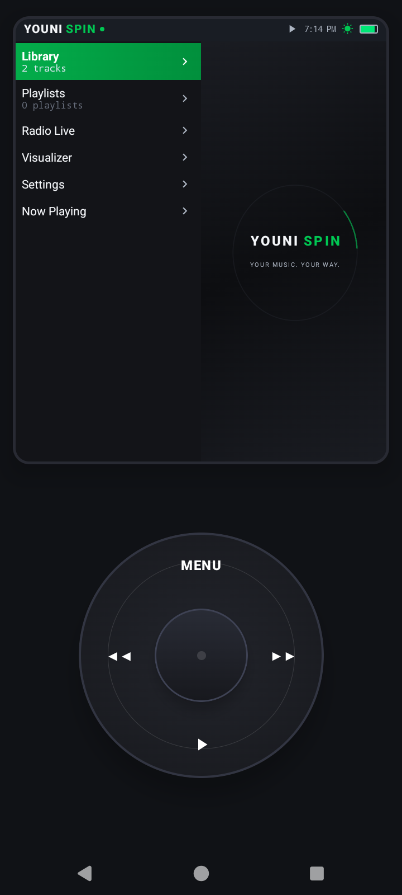
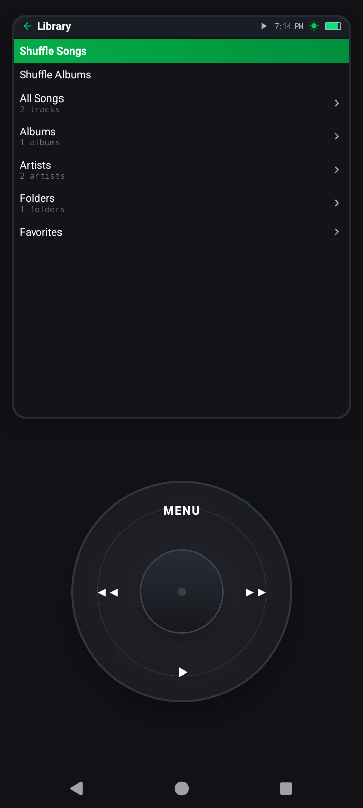
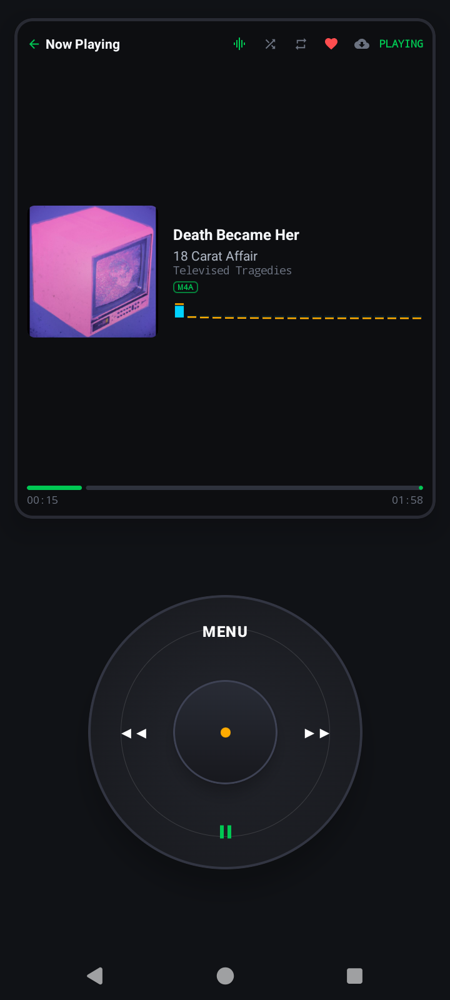
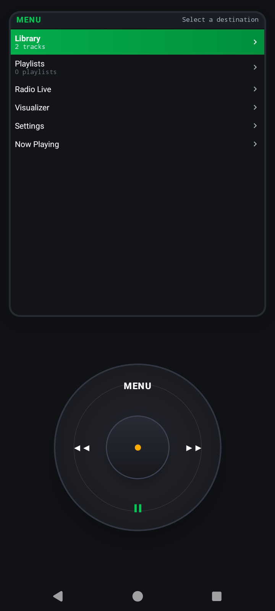
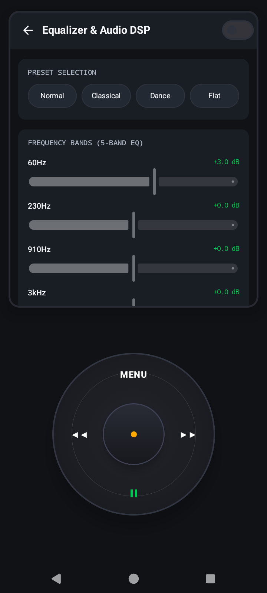
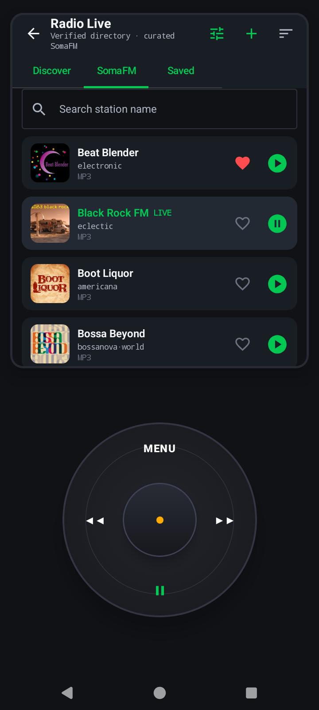

# YouniSpin

YouniSpin is a local-first Android music player with a classic handheld-player
layout, a tactile Orbit Dial, background playback, and Internet radio. It is
designed to keep everyday music controls focused and familiar while using
Android's native media and accessibility facilities.

> **Current candidate:** v1.0.2 is a debug-signed evaluation build. It is not
> a stable production release. See [known limitations](#status-and-limitations)
> before installing.

## Screenshots

These are genuine captures from the BLU B1660V running the current candidate;
screenshots are not mockups.

| Home | Full-width Library | Now Playing |
| --- | --- | --- |
|  |  |  |

| Dismissible MENU | Equalizer | Radio Live |
| --- | --- | --- |
|  |  |  |

The Visualizer capture shows the supplied Simpsons Wave GIF animating while
radio playback continues; the GIF chooser shows the bundled selections:
[live GIF Visualizer](docs/device-evidence/younispin-candidate-visualizer-gif.png) ·
[GIF choices](docs/device-evidence/younispin-candidate-gif-choices.png)

The notification shade screenshot shows the real track cover and playback
controls: [notification capture](docs/device-evidence/younispin-candidate-notification.png).

## Highlights

- Classic portrait player interface with an Orbit Dial, center joystick
  navigation, previous/next, play/pause, and press-and-hold seeking.
- Local music library, playlists, favorites, folder browsing, and editable
  track metadata.
- Media3 background playback, system media notification, and lock-screen
  controls with current artwork, track title, artist, and transport buttons.
- Radio Browser discovery and curated SomaFM catalogue, with saved/custom
  stations and live station metadata.
- Optional MusicBrainz metadata search and Cover Art Archive artwork lookup.
  Matches are presented for review; ambiguous recordings/releases are not
  silently selected.
- Theme and accent customization, a playback-connected equalizer, and
  visualizer options with three bundled GIF backgrounds and user GIF imports.

## Android requirements

- Android 8.0 (API 26) or later.
- The project compiles against Android API 35 and targets API 35.
- Source builds use Gradle 8.10.2 and Android Gradle Plugin 8.8.2. The Android
  plugin requires JDK 17 or newer; JDK 17 is used in CI.
- Audio-library permission is required for local music. Internet access is used
  only for radio and explicitly requested online metadata searches.

## Download and install

The latest published GitHub release remains
[v1.0.1](https://github.com/TheDeveloperCal/YouniSpin/releases/tag/v1.0.1).
The v1.0.2 candidate is not published because production signing is not
configured. Device verification is documented, but the debug APK is for
evaluation only. For a source build, follow [Building](docs/BUILDING.md); APK
details and checksum are in [`docs/TEST_RESULTS.md`](docs/TEST_RESULTS.md).

For ADB installation:

```bash
adb install -r YouniSpin-v1.0.1-debug.apk
adb shell monkey -p com.youni.younispin 1
```

Installing an APK signed by a different key over another build may require
uninstalling the old build; uninstalling clears app data. Back up important
playlists/settings before doing that. The debug release uses a stable
application ID, `com.youni.younispin`.

## Build from source

See [Building](docs/BUILDING.md) for SDK setup, test, lint, and APK commands.
The short version:

```bash
./gradlew testDebugUnitTest lintDebug assembleDebug --no-daemon
```

The debug APK is written to
`app/build/outputs/apk/debug/app-debug.apk`.

## Status and limitations

Implementation and test status is tracked in
[docs/IMPLEMENTATION_STATUS.md](docs/IMPLEMENTATION_STATUS.md),
[docs/FUNCTIONALITY_MATRIX.md](docs/FUNCTIONALITY_MATRIX.md), and
[docs/TEST_RESULTS.md](docs/TEST_RESULTS.md).

Known gaps include production signing, TalkBack testing, and several radio
recovery, Bluetooth, and manual-station-management edge cases. The metadata and
two-station radio paths were verified on-device for this candidate. A feature
is not described as physically verified unless the test report records device
evidence.

## Contributing

Bug reports, focused fixes, and documentation improvements are welcome. Read
[CONTRIBUTING.md](CONTRIBUTING.md) before opening a change.

## License

YouniSpin is distributed under the MIT License. See [LICENSE](LICENSE).
Third-party libraries and artwork sources retain their respective licenses;
see [docs/OSS_AUDIT.md](docs/OSS_AUDIT.md).
