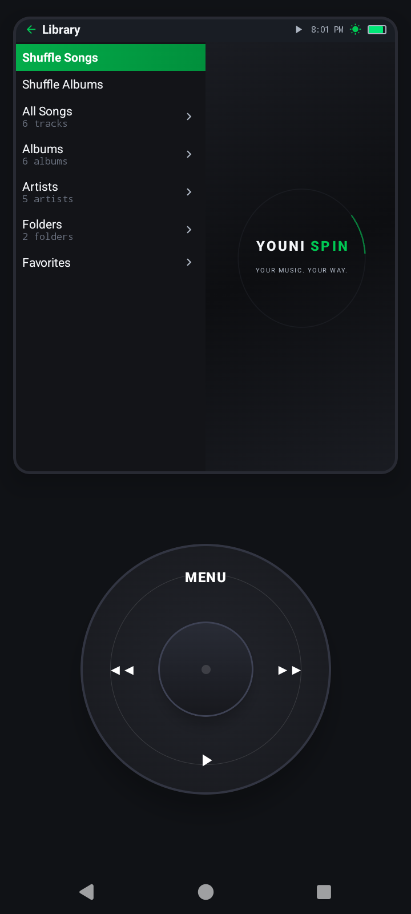
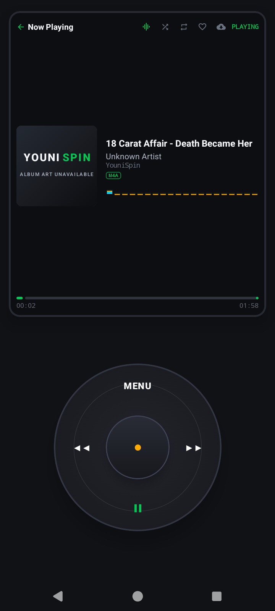

# YouniSpin


YouniSpin is a local-first Android music player with a classic handheld-player
layout, a tactile Orbit Dial, background playback, and Internet radio. It is
designed to keep everyday music controls focused and familiar while using
Android's native media and accessibility facilities.

> **Testing release:** v1.0.1 is a debug-signed APK for evaluation, not a
> production Play Store build. See [known limitations](#status-and-limitations)
> before installing.

## Screenshots

These are fresh captures from the BLU B1660V running the release candidate;
screenshots are not mockups.

| Home | Library | Now Playing |
| --- | --- | --- |
|  |  |  |

## Highlights

- Classic portrait player interface with an Orbit Dial, center joystick
  navigation, previous/next, play/pause, and press-and-hold seeking.
- Local music library, playlists, favorites, folder browsing, and editable
  track metadata.
- Media3 background playback, system media notification, and lock-screen
  controls.
- Radio Browser discovery and curated SomaFM catalogue, with saved/custom
  stations and live station metadata.
- Optional MusicBrainz metadata search and Cover Art Archive artwork lookup.
  Matches are presented for review; ambiguous recordings/releases are not
  silently selected.
- Theme and accent customization, equalizer, and visualizer/GIF options.

## Android requirements

- Android 8.0 (API 26) or later.
- The project compiles against Android API 35 and targets API 35.
- Source builds use Gradle 8.10.2 and Android Gradle Plugin 8.8.2. The Android
  plugin requires JDK 17 or newer; JDK 17 is used in CI.
- Audio-library permission is required for local music. Internet access is used
  only for radio and explicitly requested online metadata searches.

## Download and install

Download `YouniSpin-v1.0.1-debug.apk` from the
[v1.0.1 GitHub Release](https://github.com/TheDeveloperCal/YouniSpin/releases/tag/v1.0.1).
Verify its SHA-256 against the checksum file attached to that release. This
debug APK is signed with the standard development signing key and is intended
for testing. Android may ask you to allow installation from your browser or
file manager.

For ADB installation:

```bash
adb install -r YouniSpin-v1.0.1-debug.apk
adb shell monkey -p com.youni.younispin 1
```

Installing an APK signed by a different key over another build may require
uninstalling the old build; uninstalling clears app data. Back up important
playlists/settings before doing that. The debug release uses a stable
application ID, `com.youni.younispin`.

## Build from source

See [Building](docs/BUILDING.md) for SDK setup, test, lint, and APK commands.
The short version:

```bash
./gradlew testDebugUnitTest lintDebug assembleDebug --no-daemon
```

The debug APK is written to
`app/build/outputs/apk/debug/app-debug.apk`.

## Status and limitations

Implementation and test status is tracked in
[docs/IMPLEMENTATION_STATUS.md](docs/IMPLEMENTATION_STATUS.md),
[docs/FUNCTIONALITY_MATRIX.md](docs/FUNCTIONALITY_MATRIX.md), and
[docs/TEST_RESULTS.md](docs/TEST_RESULTS.md).

Known gaps include physical verification of automatic metadata matching on a
controlled incomplete-tag file, TalkBack testing, and several radio recovery,
Bluetooth, and manual-station-management edge cases. A feature is not described
as physically verified unless the test report records device evidence.

## Contributing

Bug reports, focused fixes, and documentation improvements are welcome. Read
[CONTRIBUTING.md](CONTRIBUTING.md) before opening a change.

## License

YouniSpin is distributed under the MIT License. See [LICENSE](LICENSE).
Third-party libraries and artwork sources retain their respective licenses;
see [docs/OSS_AUDIT.md](docs/OSS_AUDIT.md).
